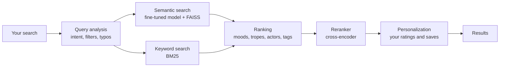

<p align="center">
  
</p>

<h1 align="center">SeoulMate</h1>

<p align="center">
  <b>Find your next K-drama by describing what you want to feel.</b><br>
  Natural-language search and personal recommendations across 2,130 Korean dramas.
</p>

<p align="center">
  <a href="https://seoulmate-azure.vercel.app"></a>
  
  <a href="LICENSE"></a>
</p>

<p align="center">
  <a href="https://seoulmate-azure.vercel.app"><b>Open the website</b></a> ·
·
  <a href="docs/README.md">Documentation</a>
</p>

> [!NOTE]
> You came here to find your next K-drama, honestly, very good choice.

## What it does

Type what you are in the mood for, the way you would ask a friend, and SeoulMate finds dramas that fit:

| You search | You get |
| --- | --- |
| `healing romance` | Gentle, feel-good love stories |
| `dramas like Crash Landing on You` | Similar stories, without the drama you named |
| `Park Bo Young` | Her dramas, lead roles first |
| `enemies to lovers` | Dramas built on that trope |
| `hospital setting` | Medical dramas set in hospitals |
| `Hospitl Playlist` | Recognises *Hospital Playlist* despite the typo and shows what to watch next (Season 2 first) |

Genre, year and rating filters narrow any search further.

SeoulMate understands moods, tropes, settings, actors and titles. It learns from what you save and rate, and has a spoiler-safe community for reviews and discussions. It runs **without any large language model**: a fine-tuned search model, classic text search and a reranker do all the work, on a regular CPU.

## Features

**Search**
- Natural-language search that mixes meaning-based (semantic) and keyword search
- Understands intent: titles, actors, genres, moods, tropes, settings
- Typo-tolerant title matching, plus genre, year and rating filters
- "More like this" recommendations on every drama page

**Your taste**
- Recommendations that adapt to your ratings, saves and clicks
- Watchlist with viewing statuses (Planned, Watching, Completed, On hold, Dropped) and personal 1–10 ratings
- Taste profile, episode tracker and *Watch Together*: find dramas two people will both enjoy
- A daily "Tonight's match" on the home page

**Community**
- Discussions, reviews (with 1–10 scores) and recommendations, linked to dramas
- Spoiler guard: spoilers stay hidden until you choose to reveal them
- Comments, likes and a trending feed

**Accounts**
- Email sign-up and login, password recovery, profile and avatar
- Guest saves merge into your account when you sign in

## How it works



1. **Query analysis** works out what you are asking for: a title, an actor, a genre, a mood. It also fixes typos and reads filters.
2. **Retrieval** finds candidates two ways: by meaning, with a sentence-embedding model fine-tuned on K-drama descriptions and a FAISS index, and by keywords, with BM25.
3. **Ranking** boosts dramas that match curated mood, trope, setting and relationship lists, MyDramaList tags, and actor billing.
4. **Reranking** re-scores the top candidates with a cross-encoder.
5. **Personalization** nudges results toward your own taste.

**In production:** the website runs on Vercel, the search API on an Azure server, and the database, accounts and posters on Supabase. See [deployment architecture](docs/deployment/DEPLOYMENT_ARCHITECTURE.md).

## Results

<p align="center">
  
</p>

> [!IMPORTANT]
> Overall accuracy reached 89.10%, honestly, a very good reason to celebrate.

Measured on a 61-search test set covering titles, typos, actors, genres, moods and filters:

| Metric | Result |
| --- | ---: |
| Overall accuracy | **89.10%** |
| Precision@3 | 66.12% |
| Recall@10 | 96.28% |
| Mean reciprocal rank | 0.992 |
| Filters, genre detection, personalization | 100% |
| Regression suite | 33/33 |

On a **held-out set** of 52 searches that no ranking rule was tuned on (expected answers taken from MyDramaList tags and cast billing):

| Held-out | P@5 | R@10 | Hit@1 |
| --- | ---: | ---: | ---: |
| Topics (42) | 68.6% | 27.9% | 71.4% |
| Actors (10) | 92.0% | 95.9% | 100% |
| All (52) | 73.1% | 40.9% | 76.9% |

Trope searches reach P@5 65.6% and R@10 78.0%; similar-drama recommendations P@5 24.0% and R@10 28.8%. The live site scores the same as a local run.

These numbers describe this benchmark, not every possible search. Precision@3 cannot go above 68.3% here, because title and typo searches have a single correct answer. Method, comparisons and limitations: [evaluation report](tests/reports/model_comparison_2026-09-30.md).

## Tech stack

| Part | Technology |
| --- | --- |
| Website | Next.js, React, TypeScript, Tailwind CSS, TanStack Query |
| API | FastAPI, Uvicorn |
| Search | Sentence Transformers, FAISS, BM25Plus, RapidFuzz, cross-encoder reranker |
| Data and accounts | Supabase (PostgreSQL, Auth, Storage), SQLAlchemy, Alembic |
| Training and data | PyTorch, pandas, NumPy; MyDramaList scraper |
| Hosting | Vercel, Azure, Supabase |

## Quick start

To try the **website on its own**, with built-in sample data (no database or API needed):

```powershell
.\scripts\run_web_frontend.ps1 -Mode mock
```

Then open http://localhost:3000.

To run the **full system** locally (Python 3.10+, Node.js, Docker Desktop with the Supabase CLI, and the model files from the [training guide](training/README.md)):

```powershell
python -m venv .venv
.\.venv\Scripts\python.exe -m pip install -r requirements.txt
supabase start
.\.venv\Scripts\python.exe -m alembic upgrade head
.\scripts\run_backend.ps1          # API on http://127.0.0.1:8001
.\scripts\run_web_frontend.ps1     # website on http://localhost:3000 (second terminal)
```

Step-by-step instructions, catalog import, posters and troubleshooting: [quick start guide](docs/guides/QUICKSTART.md).

To check search quality while the API is running: `.\scripts\run_accuracy.ps1`.

## Project structure

| Folder | What's inside |
| --- | --- |
| `frontend-web/` | Next.js website |
| `backend/` | FastAPI API: search, ranking, personalization, accounts, community |
| `training/` | Model training pipeline and search index |
| `scrapers/` | MyDramaList data collection |
| `data/` | The drama dataset and reports |
| `scripts/` | Launch, catalog release and evaluation scripts |
| `tests/` | Accuracy tests, regression suite and reports |
| `supabase/` | Local Supabase config and email templates |
| `frontend/` | Internal Streamlit tool for testing and analytics |
| `docs/` | Guides, deployment, plans and archives |

## Documentation

- [Quick start](docs/guides/QUICKSTART.md): run everything locally
- [Catalog updates](docs/guides/CATALOG_UPDATES.md): scrape new dramas, rebuild the index, release
- [Community](docs/guides/COMMUNITY.md): routes, database, API and trending formula
- [Personalization](docs/guides/PERSONALIZATION_QUICK_START.md): profiles and personalized results
- [Training](training/README.md): models and index building
- [Deployment architecture](docs/deployment/DEPLOYMENT_ARCHITECTURE.md): how production is set up
- [Website](frontend-web/README.md): frontend settings and routes
- [All docs](docs/README.md), [changelog](CHANGELOG.md) and [contributing](CONTRIBUTING.md)

## What's next

- Nightly catalog updates, so new dramas appear automatically
- Moving taste profiles and preference learning fully into the database
- Community phase 2: replies, more reactions and moderation

## License

[MIT](LICENSE)
